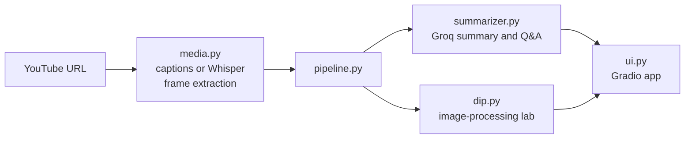

# YouTube Video Analyzer

Paste a YouTube link and get a structured summary, a searchable transcript, key frames and image-processing analysis, then ask follow-up questions about the video. Also supports capturing a slice of a live stream.

## Features

- **Transcript**: pulls the video's captions when available, and falls back to local Whisper speech-to-text on the audio
- **Summary**: LLM summary through Groq (`llama-3.3-70b-versatile` by default), with a local extractive fallback if no API key is set
- **Q&A**: ask questions about the video, answered from its transcript
- **Frame grid**: extracts evenly spaced frames and tiles them into one contact sheet
- **Image-processing lab**: runs a set of classical techniques on a frame, including Gaussian blur, Canny and Sobel edges, Laplacian sharpness, histogram equalization, CLAHE, adaptive threshold, morphological close, Harris corners, DFT spectrum and K-Means colour segmentation
- **Live mode**: analyzes a fixed-length capture from a YouTube live URL
- **Gradio UI** with a dark theme

## How it fits together

| File | Role |
|------|------|
| `config.py` | Settings and environment variables |
| `media.py` | Video ID parsing, captions, Whisper transcription, frame extraction |
| `summarizer.py` | Summaries and question answering |
| `dip.py` | Image-processing techniques and result grid |
| `pipeline.py` | Ties the steps together for video and live analysis |
| `ui.py` | Gradio interface |

## Configuration

Set these environment variables:

| Variable | Purpose |
|----------|---------|
| `GROQ_API_KEY` | LLM summaries and Q&A |
| `GEMINI_API_KEY` | Optional |
| `WHISPER_MODEL_NAME` | Whisper size, default `base` |
| `GROQ_MODEL_NAME` | Default `llama-3.3-70b-versatile` |

Needs Python, `ffmpeg`, and the packages imported in the source (`gradio`, `openai-whisper`, `opencv-python`, `groq`, `youtube-transcript-api`, `Pillow`, `numpy`).

## Status

The code is organised as a Python package (relative imports) and writes results to an `outputs/` folder one level above it. There is no `requirements.txt` or launcher script yet.
